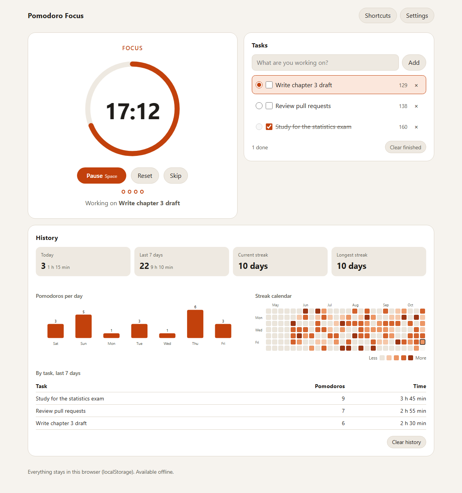

# Pomodoro Focus

A focus timer for working in 25-minute blocks with short breaks in between. You pick a task, press Space, and the app keeps time, rings a soft chime when a block ends, and keeps a history of what you worked on, including a calendar of the days you kept your streak going. It installs like an app and works without an internet connection. Nothing leaves your browser.

**Live:** https://pomodoro-focus-sigma.vercel.app



<sub>The history in the screenshot is seeded demo data (`scripts/screenshot.mjs`).</sub>

There is no framework here on purpose. The UI is five custom elements written against the DOM directly, built with Vite and typed with TypeScript. The goal was to show the fundamentals: timing that holds up under browser throttling, Web Components with Shadow DOM, a service worker written by hand, and accessibility handled deliberately rather than left to a library.

## Contents

- [What it does](#what-it-does)
- [Why the timer stays accurate in a background tab](#why-the-timer-stays-accurate-in-a-background-tab)
- [Offline: what the service worker caches and why](#offline-what-the-service-worker-caches-and-why)
- [Keyboard shortcuts](#keyboard-shortcuts)
- [Accessibility](#accessibility)
- [How the code is laid out](#how-the-code-is-laid-out)
- [Tests](#tests)
- [Running it](#running-it)
- [Known limits](#known-limits)

## What it does

- **Cycles:** focus, short break, and a long break after every N focus sessions. All four numbers are configurable, and so is whether breaks and focus sessions start on their own.
- **Tasks:** each finished focus session is credited to the task marked as active. Deleting a task keeps its history under its old name.
- **History:** today, the last seven days as a bar chart, sessions per task, the current and longest streak, and a 26-week heatmap. The heatmap and the bar chart are hand-built SVG.
- **Alerts:** a two-note chime made with the Web Audio API (no audio files), and a desktop notification when the tab is in the background, if you allow it.
- **Title bar:** while the timer runs the tab title reads `17:12 Focus | Pomodoro Focus`, so you can see it from another tab.
- **Themes:** light and dark, following the system by default. Breaks switch the accent from orange to teal.
- **Storage:** everything (settings, tasks, history, the running timer) lives in `localStorage`. Reload the page in the middle of a session and it carries on. Two open tabs stay in sync through the `storage` event.

## Why the timer stays accurate in a background tab

The obvious way to build a countdown is `setInterval(() => remaining--, 1000)`. It drifts, and in a background tab it gets badly wrong: browsers throttle timers in hidden tabs (Chrome can hold chained timers to once a minute), and a laptop that sleeps fires no timers at all. A counter that only moves when the callback runs falls behind by however long the callback was held up.

This timer never counts. The state stores *when* the running stretch started and how much time was already used before it. Remaining time is computed from the clock every time someone asks:

```ts
// src/timer/engine.ts
export function elapsedMs(state: TimerState, now: number): number {
  if (state.status !== 'running' || state.startedAt === null) return state.elapsed
  // A clock that moved backwards must not add negative time.
  return state.elapsed + Math.max(0, now - state.startedAt)
}

export function remainingMs(state: TimerState, config: TimerConfig, now: number): number {
  return Math.max(0, phaseDuration(state.phase, config) - elapsedMs(state, now))
}
```

Timers are only used as a reminder to look again. However late that reminder comes, the answer is correct. When a phase has ended, `advance()` closes it at its exact end time, not at the moment we noticed, and if the next phase starts on its own it starts at that same instant. A tab that slept through a focus session and a break therefore wakes up with both recorded at the right times and the next session already the right amount of minutes in.

Some smaller details:

- `Date.now()` rather than `performance.now()`, because the state has to survive a reload and `performance.now()` restarts at zero with every page.
- While visible, the controller wakes up at each whole-second boundary (`remaining % 1000`), so the display changes exactly when the rounded value does instead of up to a second late.
- While hidden, it stops ticking and sets a single timeout for the end of the phase. It also re-checks on `visibilitychange`, `focus` and `pageshow`.
- There is no Web Worker. A worker's timers are throttled less, but they would still need the same timestamp maths to be correct after sleep, so the worker would add a message channel without adding accuracy.

The engine is a set of pure functions (`start`, `pause`, `skip`, `reset`, `advance`) that take `now` as an argument, which is what makes the tests below possible.

## Offline: what the service worker caches and why

`src/sw.ts` is about 80 lines with no Workbox or PWA plugin. Vite builds it as a second entry point and writes it to `/sw.js` at the site root.

| Request | Strategy | Why |
| --- | --- | --- |
| Page loads (navigations) | Network first, then cached `index.html` | A new deploy shows up as soon as you are online. Offline, every URL gets the app shell. |
| `/assets/*`, icons, manifest | Cache first, then network | Vite puts a content hash in asset names, so a cached file can never be stale. |
| Everything else | Not intercepted | There is no API to cache. |

**Install.** The worker downloads `index.html` with `cache: 'no-store'` and reads the `<script>` and `<link>` URLs out of it (`assetsFromHtml` in `src/sw/precache.ts`). That is how it learns the hashed file names without a build plugin generating a manifest. It caches those files plus the icons, then calls `skipWaiting()`. Taking over immediately is safe here because the app reads all its state from `localStorage`, not from memory owned by the old version.

**Versioning.** `vite.config.ts` injects a build id (the git commit) into the worker as `__BUILD_ID__`. That changes the bytes of `sw.js` on every deploy, which is what tells the browser to install the new worker, and it names the cache. On `activate` the worker deletes every `pomodoro-focus-*` cache except its own.

**Headers.** `vercel.json` serves `sw.js` with `Cache-Control: no-cache, no-store, must-revalidate` so the browser's update check is never answered from an HTTP cache, and serves `/assets/*` as `immutable` for a year. It also sets a strict Content Security Policy (`script-src 'self'`), HSTS, `X-Frame-Options: DENY`, `nosniff` and a Permissions-Policy. `style-src` allows `'unsafe-inline'` because each component's Shadow DOM carries its own `<style>` element.

The worker is only registered in production builds. In `vite dev` it would cache source modules and serve them stale.

## Keyboard shortcuts

| Key | Action |
| --- | --- |
| Space | Start, pause or resume |
| R | Reset the current phase |
| S | Skip to the next phase (a skipped focus session is not counted) |
| ? | Show the shortcut list |

Shortcuts are ignored while you type in a text field, while a dialog is open, when Ctrl, Alt or Cmd is held, and on key repeat. Space on a focused button presses the button rather than also toggling the timer. The text-field check uses `event.composedPath()[0]`: inside a Shadow DOM the event's `target` is retargeted to the component's host element, so checking `target` would miss that you are typing into the task field.

## Accessibility

- **Announcements.** The clock is `role="timer"`, which is not a live region, so screen readers do not read it every second. A separate polite live region speaks only when something meaningful happens: start, pause, resume, reset, each whole minute ("24 minutes left."), and phase changes ("Focus session complete. Short break started, 5 minutes."). The rules are a pure function, `announcement(prev, next)`, with its own tests.
- **Reduced motion.** With `prefers-reduced-motion: reduce` the progress ring stops animating between seconds, the slow "breathing" scale effect is off, and theme transitions are instant.
- **Everything else.** A skip link, visible focus outlines, labelled controls (`aria-label="Mark Write report as done"`), native `<dialog>` for settings and help, `aria-keyshortcuts` on the buttons, and a text summary for both charts. Focus is restored after the task list re-renders, so ticking a checkbox does not throw a keyboard user back to the top.

## How the code is laid out

```
src/
  timer/engine.ts         pure state machine: start, pause, skip, reset, advance
  timer/controller.ts     clock, the single scheduled timeout, persistence, events
  lib/history.ts          sessions, day keys, weekly totals, streaks, heatmap cells
  lib/tasks.ts            task list with an active task
  lib/announcer.ts        what a screen reader should hear, and when
  lib/shortcuts.ts        keydown to action, with the text-field rules
  lib/sound.ts            Web Audio chime
  lib/notify.ts           desktop notifications
  lib/settings.ts         validated, clamped settings
  lib/storage.ts          localStorage JSON helpers that never throw
  components/             <pf-timer> <pf-tasks> <pf-history> <pf-heatmap> <pf-settings>
  sw.ts, sw/precache.ts   service worker and its testable helpers
```

The components only render what they are given and report user actions as events (`timer-action`, `settings-change`). `main.ts` connects them to the controller and the stores. Theme colours are CSS custom properties on `:root`, which pass through the shadow boundary, so one set of tokens styles every component.

## Tests

`npm test` runs 107 Vitest tests in happy-dom. `npm run test:e2e` runs 4 Playwright tests against a production build.

- **Timer engine (21):** pausing and resuming, a clock that jumps backwards, the long break after N sessions, and catching up several phases after a long sleep with exact end times.
- **Controller with fake timers (11):** `vi.useFakeTimers()` drives the per-second ticks. To simulate throttling and sleep the tests move the system clock with `vi.setSystemTime()` *without* running timers, then let one late callback or a `visibilitychange` through, and check that the countdown and the completion time are still exact. Also: one timeout while hidden, reload restore, corrupt saved state, and a second tab adopting the running timer.
- **History and streaks (20):** the test run pins `TZ=America/New_York` so day boundaries are deterministic, and includes the 1 November 2026 DST change. One test shows that adding `24 * 60 * 60 * 1000` lands on 1 November twice, which is why `addDays` goes through `setDate`. Also: late-night sessions, a streak that survives an empty today, per-task totals, the heatmap grid, the record cap, and two tabs writing at once.
- **Everything else (55):** rendering and events of the custom elements (including HTML escaping of task titles), the task store, the shortcut rules inside a shadow root, every announcement, clamping of bad settings, clock formatting, the chime and notification fallbacks, and the cache strategy table.
- **Playwright (4):** `page.clock` fast-forwards a full 25-minute session and checks the switch to the break, the title, the live-region message, today's count, the task's count and the heatmap cell, then reloads to check persistence. A second test jumps the clock 27 minutes in one step and checks that the break shows 3 minutes left, not 5. The others cover shortcuts and loading offline through the service worker.

CI (`.github/workflows/ci.yml`) runs lint, typecheck, unit tests, the build and `npm audit --audit-level=high`, then runs Playwright inside the `mcr.microsoft.com/playwright:v1.55.1-noble` container.

## Running it

Requires Node 22 (see `.nvmrc`).

```sh
npm ci
npm run dev          # http://localhost:5173, no service worker in dev
npm test             # unit tests
npx playwright install chromium
npm run test:e2e     # builds, serves on port 47270, runs the browser tests
npm run build        # output in dist/
npm run smoke -- https://pomodoro-focus-sigma.vercel.app shot.png   # console errors + service worker check
```

To run the browser tests against a deployed copy instead: `BASE_URL=https://pomodoro-focus-sigma.vercel.app npx playwright test`.

## Known limits

- **Background alerts depend on the browser.** The time is always right when you come back, but the chime and notification fire when a timer callback runs. If a browser holds back the one end-of-phase timeout (for example on a phone with the screen off), the alert comes late. Only a push server could fix that, and this app has no server on purpose.
- **Audio needs a click first.** Browsers block sound until the page has had a user gesture, so the audio is unlocked when you press Start. If the first thing that happens after a reload is a phase ending, there is no chime.
- **History is per browser.** No account and no sync. Clearing site data clears your history.
- **Two tabs can both ring.** They share one timer through `localStorage` and history is de-duplicated, but each open tab plays its own chime when a phase ends.

## License

MIT. See [LICENSE](LICENSE).
